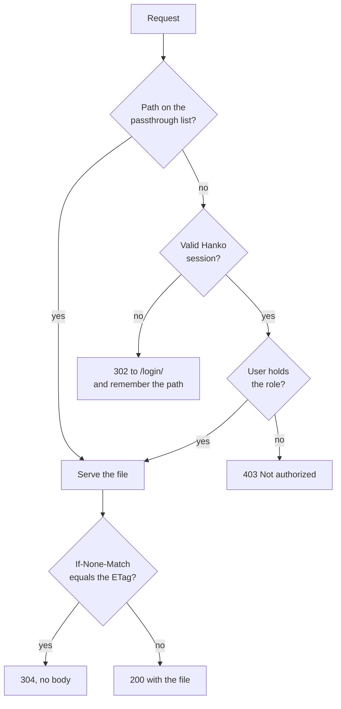

# demo-static-gating

A Hugo site embedded in a Go binary, and served only to readers who hold a valid [Hanko](https://www.hanko.io) session **and** a role you granted them. It is the companion to the blog post [Keep the site static, put a Go server in front of it](https://amfelt.com/blog/gating-a-static-site-with-go/).

> [!WARNING]
> **This is a proof of concept, not a hardened server.** It shows how the pieces fit together and leaves out everything a public deployment needs: rate limiting, security headers, server timeouts, trusted-proxy configuration, graceful shutdown, TLS, and a cache in front of the Hanko session check. See [What this leaves out](#what-this-leaves-out) before you put anything like it on the internet.

## What is in here

```text
site/     A Hinode site with mod-hanko. Hugo builds it into server/dist.
server/   A Gin server that embeds server/dist and guards every request.
Makefile  Builds the site, then the binary, and runs it.
```

The order matters. `//go:embed` reads `server/dist` when the binary **compiles**, so the site has to be built first, and a change to the site needs a new binary.

## Try it without Hanko

You need Go, Node.js and [Dart Sass](https://sass-lang.com/install/) on your `PATH`. Hugo comes in through npm.

```sh
make dev
```

Open <http://localhost:8080>. `make dev` builds everything and starts the server with `--dev-subject`, which skips Hanko and treats every request as the placeholder user in [`server/demo.toml`](server/demo.toml). That user holds the `staff` role, so every page opens.

To see what a signed-in stranger gets, pretend to be someone without the role:

```sh
make dev DEV_SUBJECT=someone-else
```

Every page now answers `403 Not authorized`. The server refuses `--dev-subject` on anything but a loopback address.

## Run it against Hanko

1. Create a project in the [Hanko console](https://cloud.hanko.io) ([setup guide](https://docs.hanko.io/setup-hanko-cloud)) and allow `http://localhost:8080` as its app URL.
2. Start the server with the project's API URL:

   ```sh
   make run HANKO_API_URL=https://<your-project>.hanko.io
   ```

3. Open <http://localhost:8080>. You are sent to `/login/`. Sign up, and you land on a `403`: you have a valid session, but no role.
4. Find your user ID in the Hanko console, and add a grant to [`server/demo.toml`](server/demo.toml):

   ```toml
   [[grant]]
     subject = "<your Hanko user ID>"
     roles   = ["staff"]
   ```

5. Stop the server, run `make run HANKO_API_URL=…` again, and reload. You are in, and taking access away is deleting those three lines.

The same URL goes to two places. Hugo bakes it into the login page (`HUGO_PARAMS_MODULES_HANKO_ENDPOINT`), and the server uses it to check sessions (`HANKO_API_URL`). The Makefile sets both from `HANKO_API_URL`.

## How a request is handled



The gate lives in [`server/auth.go`](server/auth.go), the file server in [`server/static.go`](server/static.go), and [`server/main.go`](server/main.go) wires them together. The tests in [`server/server_test.go`](server/server_test.go) cover each branch above.

## The parts that are easy to get wrong

The blog post shows the core of each piece. These are the decisions around them that the snippets leave implicit.

### A session is not enough

If your Hanko project lets people sign up, anyone can get a valid session. The server therefore also requires a role, looked up by the Hanko user ID in a grants table, and refuses to start when `require-role` is empty. Key the grants on the user ID, never on an email address: an address can change hands.

### A missing role is a 403, not a redirect

A signed-in reader without the role gets a plain page written by the server itself. Redirecting them to `/login/` would sign them straight back into the same session and loop. The denial page is inline rather than part of the site, because a page in the site sits behind the same gate.

### The passthrough list is public

The login page has to load its CSS, fonts and scripts before anyone has signed in, so those folders skip the gate. **Everything in them is readable by anyone.** Check what your build writes there. Two things to watch for:

- Hinode writes its full-text search index to `/js/flexsearch-index.en.json`. With `/js/*` on the list, every page's text would be downloadable without signing in. The demo lets only `/js/*.js` and `/js/*.mjs` through, so the scripts load and the index stays behind the gate. It also sets `lazyLoad`, so the index is fetched on the first search rather than on every page, including the login page, where the request could only fail.
- `/img/` holds the login page's favicons, and also every image your pages use: diagrams, screenshots, mockups. The demo lists the favicon and logo files it needs, not the whole folder.

### Match on the cleaned path

The gate cleans the URL path before comparing it with the passthrough list, and the file server opens that same cleaned path. Comparing the raw path would let `/css/../docs/` through as a CSS request and then serve `/docs/`. Browsers normalize `..` themselves; `curl --path-as-is` does not.

### What goes into the binary

The embed pattern is a bare `dist`, not `all:dist`. The plain [pattern](https://pkg.go.dev/embed#hdr-Directives) skips files whose names start with a dot or an underscore, so a stray `.env` in the build folder never ships. The file server also refuses any such path with a 404, in case one gets in anyway.

Everything else Hugo writes does ship, including files no page uses. Hinode imports Mermaid, and its static bundles, about 42 MB, land in the output whether or not a page draws a diagram. Setting `disable = true` on a module Hinode imports has no effect, so [`site/config/_default/hugo.toml`](site/config/_default/hugo.toml) sets `ignoreImports` on Hinode and lists its modules without Mermaid. That takes the embedded site from 45 MB to 3 MB. The catch is that the list has to be kept in step with Hinode's when you upgrade. `make check-imports` compares the two, and CI runs it, so a module update that changes Hinode's list fails the build instead of merging.

### Two cache policies

Hugo puts a content hash in the names of its CSS and JavaScript bundles. Those are cached for a year as `immutable`, and the match is on the hash rather than the folder, because `/css/` and `/js/` also hold files that keep their name when their contents change.

Everything else is `private, no-cache`: the browser revalidates on every request, and `private` keeps a shared cache, such as a CDN in front of the server, from storing a gated page and handing it to the next visitor.

### ETags have to be quoted

Embedded files have no modification time, so `http.FileServer` has nothing to answer a conditional request with. The server hashes each file once, keeps the hash in memory, and sends it as the ETag. The quotes are part of the value: `http.ServeContent` only matches `If-None-Match` against a quoted entity tag, and an unquoted one means every revalidation downloads the whole file again.

### Coming back to the right page

When the gate sends a page load to `/login/`, it saves the requested path in a short-lived `demo_return_to` cookie. After sign-in, mod-hanko sends the browser to `/post-login/`, where [`return-path.js`](site/assets/js/critical/return-path.js) reads the cookie, checks it is a same-origin path, clears it, and redirects. The same script saves the path when a session expires mid-read.

## What this leaves out

Deliberately, to keep the moving parts visible:

| Missing | Where to start |
| --- | --- |
| Rate limiting | [gin-gonic/examples: ratelimiter](https://github.com/gin-gonic/examples/tree/master/ratelimiter). Don't reuse the passthrough list as the limiter's exemptions: a narrow list like this one leaves page images and the search index gated, so a per-user budget would count every image a reader loads. Exempt the asset folders separately |
| Security headers (CSP, HSTS, framing) | [gin-contrib/secure](https://github.com/gin-contrib/secure), and add your Hanko URL to `connect-src` |
| Server timeouts | [`http.Server`](https://pkg.go.dev/net/http#Server): set `ReadHeaderTimeout` at least, and serve through it instead of `r.Run` |
| Graceful shutdown | [gin-gonic/examples: graceful-shutdown](https://github.com/gin-gonic/examples/tree/master/graceful-shutdown) |
| Trusted proxies | [`SetTrustedProxies`](https://pkg.go.dev/github.com/gin-gonic/gin#Engine.SetTrustedProxies) with your edge's address range; this demo trusts none |
| TLS | [gin-gonic/examples: auto-tls](https://github.com/gin-gonic/examples/tree/master/auto-tls), or terminate at your platform's edge |
| Compression | [gin-contrib/gzip](https://github.com/gin-contrib/gzip) |
| Session check cache | Every gated request calls Hanko, and with page images gated, that means every image on a page too. Cache valid answers for a few seconds; the shorter the cache, the sooner a revoked user is locked out |
| Config reload | Grants load at startup, so changing access means a restart |

## Credits

The site uses [Hinode](https://github.com/gethinode/hinode) and [mod-hanko](https://github.com/gethinode/mod-hanko), both MIT-licensed. Sign-in is [Hanko](https://www.hanko.io), whose [backend](https://github.com/teamhanko/hanko) you can also run yourself.

## License

[MIT](LICENSE)
